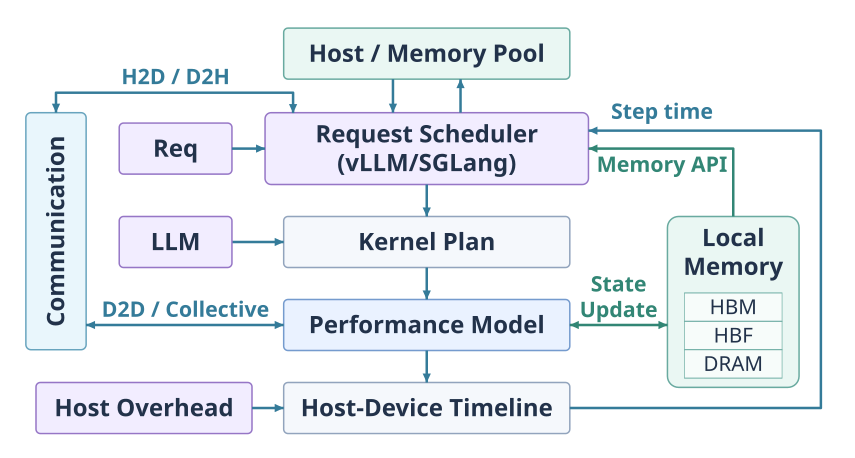

<h1 align="center">Uni<sup>3</sup>Sim: Simulation for LLM Serving at Scale</h1>

<p align="center">
  <a href="https://thu-nics.github.io/uni3sim-website/">Website</a>
</p>

Uni³Sim predicts LLM inference latency and throughput by combining framework execution models with analytical models of compute, memory, and interconnects. Explore how workloads, parallelism, and hardware choices affect the whole system.

## Features

- **Framework-aware serving.** Model batching, scheduling, and parallel execution through vLLM and SGLang paths.
- **Shared host-device timeline.** Follow compute, memory transfers, and communication together to find bottlenecks.
- **Hardware exploration.** Compare accelerator and memory-system designs using hardware specifications and independent microbenchmarks.



## Quickstart

Prerequisites: Linux, Python 3.10 or later, Git LFS, and a C compiler. The examples below run on the CPU without model weights or a GPU.

```bash
git clone --recurse-submodules https://github.com/thu-nics/uni3sim.git
cd uni3sim
git lfs install --local
git lfs pull

python3 -m venv .venv
source .venv/bin/activate
python -m pip install -r requirements-reports.txt
mkdir -p build
cc -O3 -shared -fPIC -o build/lru_sim.so src/kernel/csrc/lru_sim.c
```

**Predict Kernel performance** and generate an interactive report:

```bash
python scripts/evaluation/kernel/run_kernel_evaluation.py \
  --hardware-id nvidia_a800 --mode forward --interactive-report
```

The command prints the report path. Open the HTML file directly in your browser.

**Explore a Serving timeline** with the synthetic CPU example:

```bash
python scripts/experiments/run_serving_experiments.py \
  --manifest configs/evaluation/experiments/cpu_qwen3_conformance_example.json \
  --run-dir experiment_logs/serving/demo --cpu-run
```

Open `experiment_logs/serving/demo/conformance/result.html`. This synthetic example checks execution and reporting; hardware accuracy is evaluated separately.

## Learn more

- [Serving models and support](docs/serving_system.md)
- [Kernel performance models](docs/kernel_performance_model.md)

Backend support and validation scope are documented in the guides above.
